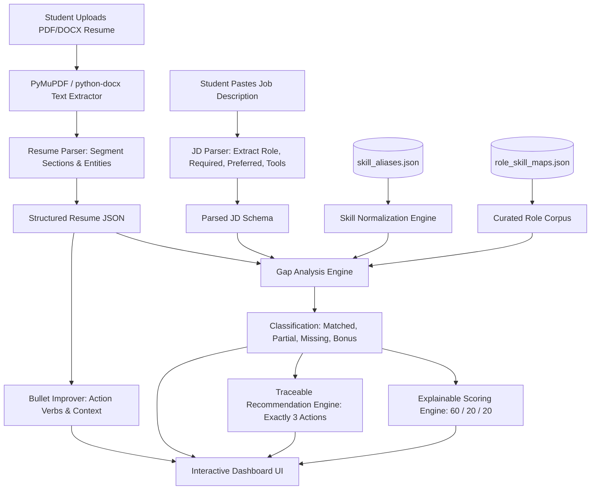

# 🎯 Resume ↔ JD Gap Analyzer (S-2 Internship Project)

> **Production-Quality Web Application for Structured Resume Extraction, Deterministic Job Description Matching, Explainable Gap Scoring, and Grounded Career Recommendations.**

[](file:///C:/Users/Saran/.gemini/antigravity-ide/scratch/resume-jd-gap-analyzer/backend/tests)
[](file:///C:/Users/Saran/.gemini/antigravity-ide/scratch/resume-jd-gap-analyzer/frontend)
[](file:///C:/Users/Saran/.gemini/antigravity-ide/scratch/resume-jd-gap-analyzer/backend)

---

## 📌 1. Project Overview & Problem Statement

Job-seeking students often face uncertainty when applying to technical roles: they submit resumes without knowing whether their skills match employer requirements or how to bridge specific technical gaps. Traditional keyword search tools are fragile, while generic AI prompts often hallucinate experience or provide arbitrary ratings.

**Resume ↔ JD Gap Analyzer** solves this through:
1. **Document Processing**: Extracts text from real **PDF** and **Word DOCX** resumes.
2. **Structured JSON Normalization**: Converts raw resume text into structured schemas (`skills`, `projects`, `education`, `experience`, `certifications`).
3. **Role Skill-Map Corpus**: Grounds analysis against curated industry benchmark skill maps (`Frontend`, `Data`, `QA`, `Support`).
4. **Deterministic & Semantic Gap Classification**:
   - **`MATCHED`**: Direct evidence demonstrated in skills or project work.
   - **`PARTIAL`**: Foundational skill present (e.g. JavaScript found when React is required), but required technology not proven.
   - **`MISSING`**: Required by JD or role expectations, but no sufficient resume evidence found.
   - **`BONUS`**: Candidate strengths outside the JD requirements.
5. **Transparent Scoring Formula (0–100)**: Explainable weighted coverage (`Required: 60%`, `Preferred: 20%`, `Role Alignment: 20%`).
6. **Exactly 3 Traceable Recommendations**: Every recommendation is strictly grounded in `JD_REQUIRED`, `JD_PREFERRED`, or `ROLE_SKILL_MAP` with verbatim text evidence.
7. **Stretch Feature — Resume Bullet Rewriter**: Transforms passive bullets into high-impact action statements with **Zero Metric / Claim Fabrication**, with interactive Accept, Reject, and Edit controls.

---

## 🏗️ 2. System Architecture & Data Flow



---

## 🛠️ 3. Technology Stack

### **Frontend**
- **Framework**: React 18 with TypeScript and Vite 5
- **Styling**: Tailwind CSS with custom theme tokens & Plus Jakarta Sans typography
- **Icons**: Lucide Icons
- **HTTP Client**: Axios with typed request/response contracts

### **Backend**
- **Framework**: Python 3.12 + FastAPI + Uvicorn
- **Document Parsers**: PyMuPDF (`fitz`/`pymupdf`) for PDF parsing, `python-docx` for Word DOCX
- **NLP & Similarity**: RapidFuzz + regular expression boundary analyzers
- **Data Validation**: Pydantic v2 schemas
- **Testing**: PyTest with automated test suites for document parsing, gap analysis, and API routes

---

## 📊 4. Gap Matching & Scoring Methodology

### Skill Categorization
| Category | Definition | Example Scenario |
| :--- | :--- | :--- |
| **`MATCHED`** (100% credit) | Clear, direct evidence exists in resume skills or project descriptions | JD requires `React`, Resume lists `React` under Projects |
| **`PARTIAL`** (50% credit) | Related foundational technology present, but required tool not explicitly proven | JD requires `React`, Resume only demonstrates `JavaScript` |
| **`MISSING`** (0% credit) | Required by JD or curated role map, but no resume evidence exists | JD requires `Docker`, Resume has no mention of Docker |
| **`BONUS`** | Technical skill demonstrated in resume not explicitly requested | Resume contains `PostgreSQL` for a generic frontend posting |

### Transparent Score Formula
$$\text{Composite Score} = (\text{Required Coverage} \times 0.60) + (\text{Preferred Coverage} \times 0.20) + (\text{Role Alignment} \times 0.20)$$

---

## ⚡ 5. Quick Start & Installation

### Prerequisites
- Python 3.10+
- Node.js 18+ and npm

### 1. Start the Backend API

```powershell
cd backend
pip install -r requirements.txt
python -m uvicorn app.main:app --reload --port 8000
```
- Backend API will run at: `http://127.0.0.1:8000`
- Interactive Swagger UI: `http://127.0.0.1:8000/docs`

### 2. Start the Frontend Application

```powershell
cd frontend
npm install
npm run dev
```
- Frontend UI will open at: `http://localhost:5173`

---

## 🧪 6. Running Automated Tests

Run the full pytest suite in the `backend/` directory:

```powershell
cd backend
python -m pytest -v
```

### Verified Test Cases:
- ✅ **Case 1**: Resume `JavaScript` + JD `React` $\to$ `Partial`
- ✅ **Case 2**: Resume `React` + JD `React` $\to$ `Matched`
- ✅ **Case 3**: Resume `No Docker` + JD `Docker` $\to$ `Missing`
- ✅ **Case 4**: Empty Resume Handling $\to$ Friendly validation error
- ✅ **Case 5**: Empty JD Handling $\to$ Friendly validation error
- ✅ **Document Uploads**: Real `.pdf` and `.docx` file byte parsing and entity extraction
- ✅ **Recommendations**: Exactly 3 traceable recommendations with `JD_REQUIRED`, `JD_PREFERRED`, `ROLE_SKILL_MAP` sources
- ✅ **Bullet Rewriting**: Action verb improvement with **Zero Metric / Technology Fabrication**

---

## 🎬 7. How to Demonstrate During Internship Review

1. **Open the Application**: Navigate to `http://localhost:5173`.
2. **Click "Try Demo"**:
   - Automatically loads a standard student resume (`HTML`, `CSS`, `JavaScript`, `Git`).
   - Pairs it with a Frontend Developer JD requiring `HTML`, `CSS`, `JavaScript`, `React`, `Git` and preferred `REST APIs`.
   - Generates an instant gap report with score ~78/100.
3. **Inspect the Skill Coverage**:
   - Highlight **Matched Skills**: `HTML`, `CSS`, `JavaScript`, `Git`.
   - Highlight **Partial Skill**: `React` (explain why it's partial: JavaScript is foundational, but React is not explicitly proven).
   - Highlight **Missing Skill**: `REST APIs`.
4. **Inspect the 3 Traceable Recommendations**:
   - Demonstrate the source badges (`JD REQUIRED`, `JD PREFERRED`, `ROLE SKILL MAP`).
   - Expand the evidence card to show verbatim citations from the job description.
5. **Demonstrate Resume Bullet Rewriter**:
   - Pick an existing bullet: `"Created a website using JavaScript."`
   - Click **Enhance** $\to$ observe transformation to: `"Developed a responsive web application leveraging JavaScript with modular component architecture and cross-browser compatibility."`
   - Click **Edit**, modify a phrase, and click **Accept Suggestion**.
6. **Upload a Real File**:
   - Upload `backend/tests/samples/sample_resume_frontend.pdf` or `sample_resume_qa.docx` to demonstrate live PyMuPDF and python-docx parsing.

---

## 🔒 8. Security & Privacy Considerations

- **No Remote File Storage**: Uploaded resumes are processed in-memory and not stored on public file servers.
- **Payload Limits**: Enforces a strict 10MB file limit to prevent resource exhaustion.
- **Input Sanitization**: All extracted document strings and pasted JD text are sanitized against script injection.
- **Deterministic Privacy**: Analysis runs locally without sending private candidate data to third-party endpoints unless explicitly configured.
